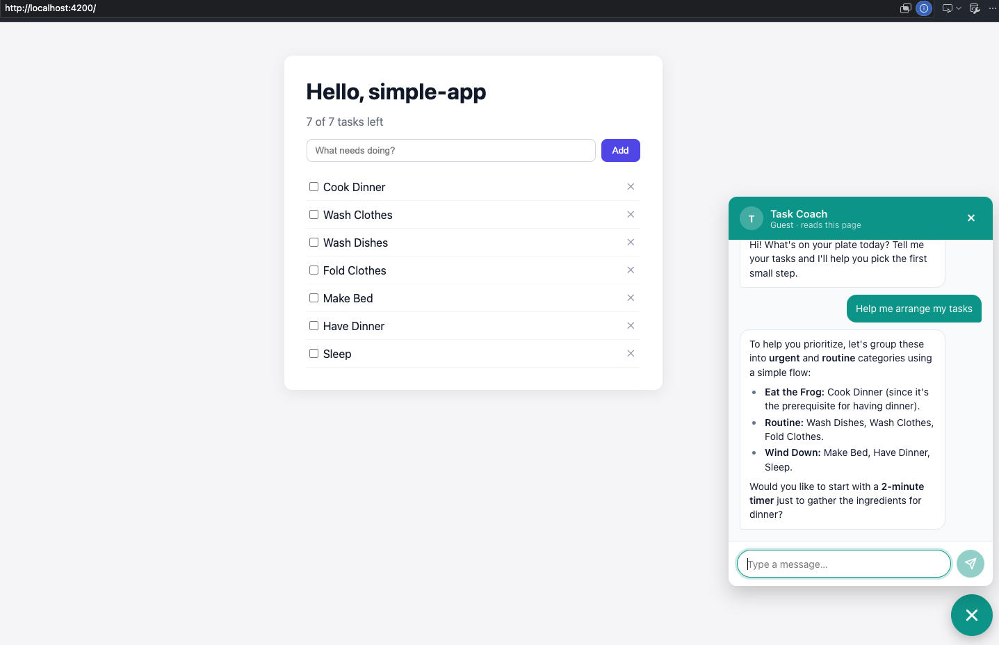
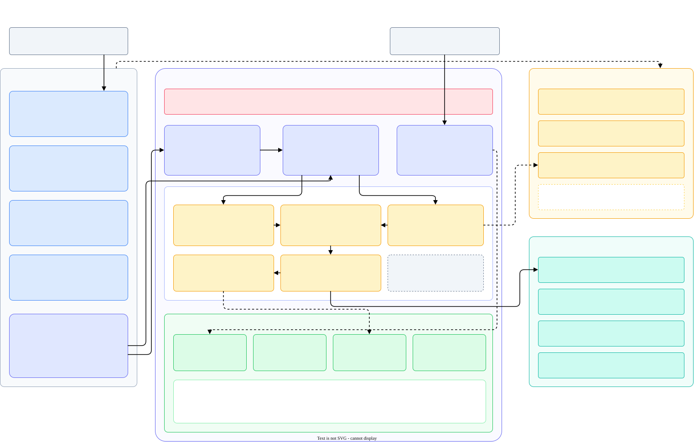
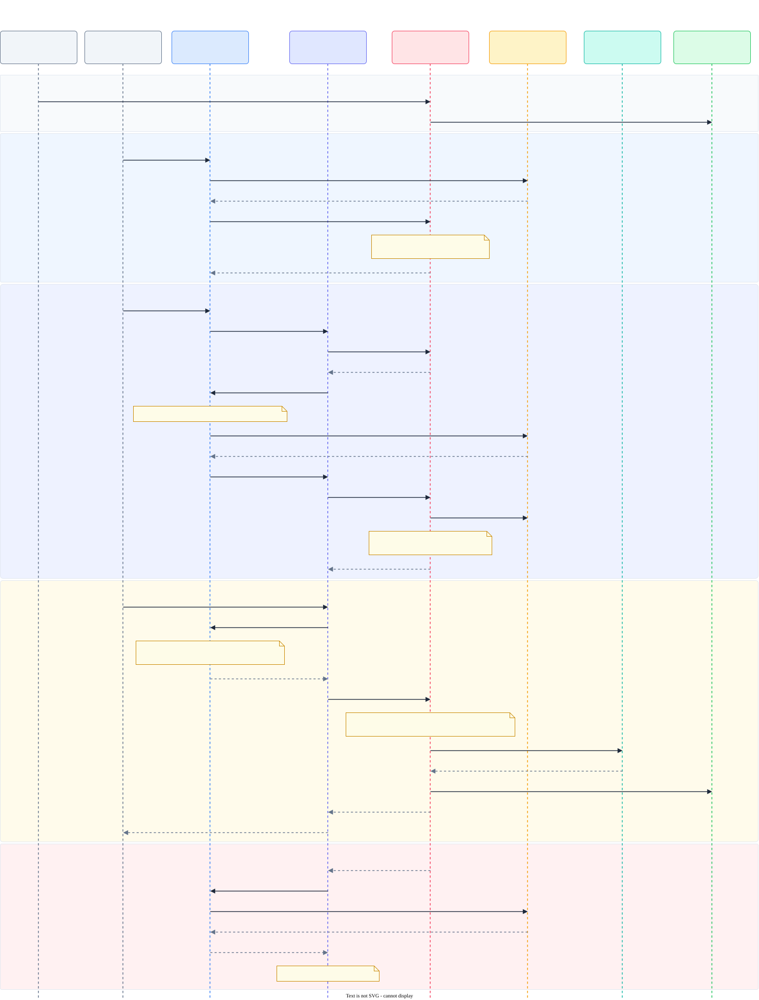

# Bot Control Plane

Multi-tenant control plane + embeddable chat widget. Configure bots at `/`, watch what they do at `/activity`, embed anywhere with:

```html
<script src="https://YOUR-GATEWAY/widget.js" data-bot-id="bot_internal_1" async></script>
```



*The `pub_task_coach` bot on an Angular app (`localhost:4200`): it reads the task list on screen and helps prioritize it.
More results (a Salesforce call-center copilot and a role-aware Entra ID assistant) are in the
[user guide](docs/USER-GUIDE.md#what-you-get).*

## Quick start: create and use a bot

1. **Run it:** `docker compose up --build -d`, then open <http://localhost:3000>.
2. **Create a bot:** click **+ Create New Bot** (sign-in verification, screen reading and Gemma 4 come pre-configured). Set a Bot ID, name and look, and add your site under **Allowed domains** (e.g. `http://localhost:4200`). Choose who the users are under **User Identity** (guests, Auth0 or Entra ID), click **Test connection** under Agent Routing, then **Create bot**.
3. **Embed it:** copy the snippet from the right-hand column into your page (`src/index.html` for Angular):

   ```html
   <script src="http://localhost:3000/widget.js" data-bot-id="pub_task_coach" async></script>
   ```

   For signed-in users, also give the widget a token provider: `window.NextBot = { getAuthToken: () => /* MSAL or Auth0 access token */ }`.
4. **Use it:** open your site, click the launcher, and ask about what's on screen ("help me arrange my tasks", "who does this policy belong to?").
5. **Watch it:** **Activity** shows every chat with the verified user and what the bot saw on screen.

The [**user guide**](docs/USER-GUIDE.md) walks through every editor section with screenshots. It also has Angular
(MSAL / Auth0), WordPress and Salesforce embedding, testing, a go-live checklist and troubleshooting.

## Architecture

### Conceptual diagram

One gateway serves many bots. Host sites embed `widget.js`. The gateway verifies users against each site's
identity provider, reads the screen they're on, and routes the chat to the bot's OpenAI-compatible agent.



### End-to-end flow

From configuring a bot to a screen-aware answer ("Who does this policy belong to?"), including identity verification
and silent token refresh.



**Editing the diagrams:** the source is [`docs/architecture.drawio`](docs/architecture.drawio), one file with two pages.
Open it in [draw.io](https://app.diagrams.net) or the VS Code *Draw.io Integration* extension, then run
`docs/export-diagrams.sh` to refresh the two `.drawio.svg` images above. Those SVGs also embed the diagram, so they can
be opened and edited in draw.io directly.

## Run

```bash
docker compose up --build -d     # http://localhost:3000
# or for development
npm install && npm run dev
```

## Where bots are saved, import & export

- **Local JSON:** every bot lives in `data/bots.json` on your machine (bind-mounted into the container), written atomically on each save. If it's missing, it's re-seeded with the three starter bots.
- **Automatic backups:** before every save or import, the previous `bots.json` is copied to `data/backups/bots-<timestamp>.json` (newest 30 kept). To roll back, copy a backup over `data/bots.json`.
- **Export:** *Export all* in the sidebar, or *Export JSON ↓* on a bot, downloads `{ "format": "nextbot.bots", "version": 1, "bots": [...] }`. API keys are never exported; affected bots are listed in `apiKeysOmitted`.
- **Import:** *Import JSON* accepts an export file, a plain array of bots, or a single bot object. It shows a preview first (new / exists / invalid, with reasons), then you choose to skip or overwrite existing bots. Every bot goes through the same validation as the editor, and nothing is written if any bot is invalid. On overwrite, a stored API key is kept unless the file has one.
- **API:** `GET /api/admin/bots/export[?ids=a,b]`, `POST /api/admin/bots/import` with `{ file, onConflict: "skip" | "overwrite", dryRun }`. Both are admin-only (`ADMIN_PASSWORD`).
- **Rejected saves** are logged as `[bots] rejected save of "<id>": …` in `docker compose logs`. In the editor, a sticky save bar at the bottom shows unsaved changes and errors, and the page scrolls to the error list.

### Starter pack (`examples/bot-pack.json`)

11 ready-made bots. All run on Gemma 4 with screen awareness and identity verification; import the file to add them.

| Bot | Where | Users |
| --- | --- | --- |
| `pub_task_coach` | Public productivity site: prioritization, beating procrastination, smallest next step | Guests + optional Auth0 login |
| `pub_lead_concierge` | Public marketing site: answers from the page, captures leads | Guests + optional Auth0 login |
| `wp_product_faq` | WordPress product/docs site | Guests + optional Auth0 login |
| `wp_member_support` | WordPress members area: subscriptions, renewals | Auth0 **required** |
| `sf_claims_intake` | Salesforce insurance call center: first notice of loss | Auth0 **required** |
| `sf_sales_copilot` | Salesforce sales: record summaries, next steps (host-context allowlist demo) | Entra ID **required** |
| `sf_service_cases` | Salesforce service console: case resolution, reply drafts | Entra ID **required** |
| `entra_it_helpdesk` | Internal IT helpdesk | Entra ID **required** |
| `entra_hr_assistant` | HR policies; HR.Admin role gets admin procedures | Entra ID **required** |
| `entra_team_tasks` | Internal team task board: sprint planning, task breakdown | Entra ID **required** |
| `auth0_saas_onboarding` | In-app SaaS onboarding guide | Auth0 **required** |

They trust the built-in **test** IdP. Swap issuer/audience for your real tenants (or edit the JSON and re-import with *overwrite*).

New bots created with **+ Create New Bot** copy every feature setting (sign-in verification, screen awareness, context
rules, model settings) from the Salesforce bot. Bots created via the API without those sections still get screen
awareness and formatting rules by default.

## Agent backends

Each bot's backend is configured entirely in the admin UI (**Agent Routing**) and stored on the bot in `data/bots.json`.
There are no hidden server-side defaults.

| Field | Notes |
| --- | --- |
| Endpoint URL | Any OpenAI-compatible Chat Completions API. Base URL (`…/v1`) or full `…/chat/completions`. |
| Model | Exact model id the endpoint expects. **Test connection** lists the endpoint's models (`GET /models`). |
| API key | Optional, sent as `Authorization: Bearer <key>`. Write-only: APIs and the UI only ever show a masked preview. |
| Extra request parameters | JSON merged into each request body (`temperature`, `max_tokens`, provider-specific flags). Cannot override `model`, `messages`, `stream`. |
| Formatting rules | Appended after the system prompt to keep replies short and readable in the 380px widget. |

**Quick-fill presets:** Docker Model Runner (Gemma 4), OpenAI, OpenRouter, Ollama on the host. Works the same with vLLM, LM Studio, LiteLLM, Groq, Together, etc.

The seeded bots use Gemma 4 on Docker Model Runner: `http://model-runner.docker.internal/engines/v1`, model `ai/gemma4`,
with `{"chat_template_kwargs": {"enable_thinking": false}}`. That flag skips Gemma's reasoning phase: a short reply took
17.6s / 590 tokens with thinking vs 0.5s / 8 tokens without. The `models:` entry in `docker-compose.yml` only makes Compose pull the model.

`model-runner.docker.internal` only resolves inside containers. When running `npm run dev` on the host, use
`http://localhost:12434/engines/v1` (Docker Desktop > Settings > AI > *Enable host-side TCP support*).

API keys are stored in plain text in `data/bots.json`. Protect that volume, and set `ADMIN_PASSWORD`.

## Activity

`/activity` shows, per bot: chats, widget loads, blocked requests (403/401, including foreign-origin config fetches caught by
middleware), backend errors, average response time, last activity and top host origins, plus a live, filterable,
searchable event feed. Click a row for the full message, reply, page URL, model and host context. Link to one bot with
`/activity?botId=bot_salesforce`; each bot's editor has a *View activity* link.

Events are appended to `data/activity.jsonl`. It contains end-user chat text, so treat it as sensitive. Auth tokens are
always redacted, the file is kept out of the image and git, and it is trimmed to the newest half once it exceeds
`ACTIVITY_MAX_BYTES`.

## How domain locking works

| Layer | Where | Enforces |
| --- | --- | --- |
| `Content-Security-Policy: frame-ancestors …` | `middleware.ts` on `/embed/:botId` | Only `allowedDomains` can iframe the chat UI. `'self'` is added **only** for the admin live preview (`?preview=1`). |
| CORS | `middleware.ts` on `/api/bots/:botId`, `/api/chat` | Widget config fetch / direct API calls only from `allowedDomains`. Cross-origin `/api/chat` callers must pass `?botId=` so preflights can be checked. |
| Origin check | `app/api/chat/route.ts` | Rejects foreign `Origin`; for iframe calls, also validates the host page origin (taken from the browser-verified `postMessage` origin). |
| Identity | `lib/identity.ts` | For signed-in bots, the host's token is verified (signature via the IdP's JWKS, issuer, audience, expiry). See below. |

Allowed-domain entries must be `scheme://host[:port]`, optionally with a leading `*.` subdomain wildcard (e.g. `https://*.force.com`).

## User identity

Each bot picks how it knows who the user is (**User Identity** in the editor):

| Site type | Mode | User ID comes from |
| --- | --- | --- |
| Public / open website | Anonymous | Random per-browser visitor id (`anon:…`), for grouping conversations only |
| Auth0 site | Signed-in users (JWT), Auth0 preset | Verified token claims, e.g. `sub` |
| Entra ID site | Signed-in users (JWT), Entra ID preset | Verified token claims, e.g. `oid`, `preferred_username`, `roles`, `tid` |
| Okta, Ping, Keycloak… | Signed-in users (JWT), Generic OIDC | Verified token claims |

**Trust rule:** a user ID is only trusted when it comes from a token the gateway verified itself (RS/PS/ES signature
via the issuer's `/.well-known/openid-configuration` JWKS, plus issuer, audience and expiry). Anything the page passes
with `setContext` (even `user: { email }`) is forwarded to the model as *unverified* context.

Per bot you configure: issuer, audience(s), optional JWKS URL, **require sign-in** (or fall back to guest), claim
mapping (user ID, email, name, roles, extra claims) and whether to forward identity to your agent backend as
`X-User-Id`, `X-User-Email`, `X-User-Name`, `X-User-Roles` and `X-User-Issuer` headers. **Verify token** in the editor checks a pasted
token against unsaved settings and shows the resolved user, or why it failed (issuer/audience mismatch, expired…).

The host app gives the widget a **token provider**. It's called on load and again whenever the gateway reports an
expired token, so long sessions keep working:

```html
<!-- Auth0 SPA SDK (request an access token for your API identifier) -->
<script>
  window.NextBot = { getAuthToken: () => auth0Client.getAccessTokenSilently({ authorizationParams: { audience: 'https://your-api' } }) };
</script>

<!-- Microsoft Entra ID / MSAL.js (access token for your own API scope) -->
<script>
  window.NextBot = {
    getAuthToken: async () => (await msalInstance.acquireTokenSilent({ scopes: ['api://YOUR_API_CLIENT_ID/access_as_user'], account })).accessToken,
  };
</script>

<script src="https://YOUR-GATEWAY/widget.js" data-bot-id="bot_internal_1" async></script>
```

After sign-in or sign-out without a reload, call `NextBot.setAuthToken(token)` or `NextBot.setAuthToken(null)`. Provider notes:

- **Auth0:** access tokens only contain email, name and roles if a Post-Login Action adds them as namespaced claims (e.g. `https://your-app.example/roles`). Map those names in the editor.
- **Entra ID:** set `accessTokenAcceptedVersion: 2` in the API app's manifest. Otherwise the issuer is `https://sts.windows.net/{tid}/` instead of `…/v2.0`. Single-tenant issuers only.

The resolved user is shown in the chat header ("Signed in as …"), described to the model, recorded in Activity (User
column, unique / signed-in user counts), and optionally forwarded as headers. Tokens themselves are never logged or
sent to LLM APIs.

**Test IdP:** `ENABLE_DEV_IDP=true` (on in `docker-compose.yml`) serves `/api/dev-idp/{entra|auth0}` with discovery,
JWKS and a token endpoint that issues Entra-ID-style and Auth0-style RS256 tokens for the test hosts. Anyone who can
reach it can mint tokens, so **disable it and point bots at your real tenants before going live** (the editor warns
while a bot still trusts it).

## Screen awareness & context

Users ask about what they're looking at ("who does this policy belong to?"). Two channels feed that, configured under
**Context & Screen Awareness**:

1. **Automatic page capture** (`Read the page…` = Automatic). Right before each message, `widget.js` snapshots the
   visible page: text block by block (including open shadow DOM), form fields with their labels, label/value pairs
   (`<dl>`, two-cell table rows, `…label` + `…value`/`…static` siblings such as Salesforce SLDS), and the user's
   highlighted text. Per bot you choose: which areas to read (CSS selectors), which to skip, and a size cap. Card numbers,
   SSNs and IBANs are masked in the browser and again on the server. Password and payment fields, the widget itself and
   `[data-nextbot-ignore]` elements are never read. Snapshots are fresh per message, so SPA navigation (opening another
   record) is picked up. The model is told it's page content, not instructions. Activity keeps a bounded excerpt
   ("Screen seen by bot"). The chat header shows "reads this page" so users know.
2. **Explicit context:** `NextBot.setContext({ policyNumber, recordId, … })` for exact values the app already has.
   Optionally restrict which keys reach the model (**Host context keys to forward**).

```js
window.NextBot = { context: { recordId: '…' } };         // before widget.js loads
NextBot.setContext({ recordId: '…', route: '/claims' });  // any time after
NextBot.open(); NextBot.close(); NextBot.toggle();
```

### Salesforce Lightning

Lightning Web Security stops third-party scripts from reading the record page, so automatic capture can't see a
Lightning record. Instead, add a small LWC to the record page (or the Utility Bar) that reads the fields and passes them
explicitly. Host `widget.js` as a Static Resource, and add the gateway to CSP Trusted Sites (frame-src and connect-src):

```js
// force-app/main/default/lwc/policyCopilot/policyCopilot.js
import { LightningElement, api, wire } from 'lwc';
import { loadScript } from 'lightning/platformResourceLoader';
import { getRecord, getFieldValue } from 'lightning/uiRecordApi';
import WIDGET from '@salesforce/resourceUrl/nextbot_widget';
import POLICY_NUMBER from '@salesforce/schema/Policy__c.Name';
import HOLDER from '@salesforce/schema/Policy__c.Policyholder__r.Name';
import STATUS from '@salesforce/schema/Policy__c.Status__c';

export default class PolicyCopilot extends LightningElement {
  @api recordId;
  @api objectApiName;

  @wire(getRecord, { recordId: '$recordId', fields: [POLICY_NUMBER, HOLDER, STATUS] })
  wiredRecord({ data }) {
    if (!data || !window.NextBot?.setContext) return;
    window.NextBot.setContext({
      recordId: this.recordId,
      objectApiName: this.objectApiName,
      policyNumber: getFieldValue(data, POLICY_NUMBER),
      policyholder: getFieldValue(data, HOLDER),
      status: getFieldValue(data, STATUS),
    });
  }
}
```

If the widget can't run inside Lightning at all (strict LWS settings), embed `/embed/{botId}` in a Visualforce page or
`lightning-container` and post the same fields to it with `postMessage({ type: 'INIT_CONTEXT', payload })`.
For the bot to fetch more data itself (claims history, notes), give your agent backend Salesforce API access and use
`recordId` plus the forwarded `X-User-*` identity.

## Environment

| Variable | Purpose |
| --- | --- |
| `ADMIN_PASSWORD` / `ADMIN_USER` | HTTP Basic auth for `/`, `/activity`, `/api/bots`, `/api/activity`, `/api/admin/*`. **Unset = no auth; set it anywhere beyond localhost** (the admin can store API keys and make the server call arbitrary URLs). |
| `ACTIVITY_LOG`, `ACTIVITY_MAX_BYTES` | `off` disables activity logging; max log size before trimming (default 5 MB). |
| `PUBLIC_BASE_URL` | Gateway's public origin when behind a reverse proxy (used for same-origin checks). |
| `ENABLE_DEV_IDP` | `true` enables the test-only identity provider at `/api/dev-idp/*`. **Keep `false` in production.** |

## Test hosts

- `/test-hosts/angular-mock.html?botId=…`: internal Angular portal, employees signed in with **Entra ID** (test IdP; switch Jane/Bob or sign out in the toolbar), route pushed via `setContext`, `<main>` read automatically.
- `/test-hosts/wordpress-mock.html?botId=…`: public WordPress site, **anonymous** visitors, hostile theme CSS, article read automatically.
- `/test-hosts/salesforce-mock.html?botId=…`: insurance **call-center** policy screen; agents signed in via **Auth0** (test IdP). Ask "who does this policy belong to?", open another policy and ask again. The SSN and card on screen are masked before leaving the browser. `&expireFirst=1` starts with an expired token to exercise the refresh flow.
- Add `&idp=entra` or `&idp=auth0` to sign in with a different provider on any test host. The admin's test-host links add the right one for each bot.
- Open them via `http://127.0.0.1:3000/...&gateway=http://localhost:3000` for a true cross-origin test (links are in the admin UI).

## Known limitations

- JSON file store with in-process write serialization: run **one** replica. Move to a database before scaling out. Edits made directly to `data/bots.json` while the admin page is open are overwritten by the next save from that page.
- Linux hosts: the container runs as uid 1001, so `chown -R 1001 ./data` (or adjust permissions) for the bind mount to be writable. Docker Desktop on macOS/Windows handles this automatically.
- `openai_compatible` is non-streaming, and only supports Bearer auth (not Azure's `api-key` header).
- Activity is read by loading the whole log file. Fine for the 5 MB cap; use a real store (e.g. Postgres/ClickHouse) for long retention.
