# Bot Gateway user guide

How to create a bot, put it on a website (Angular, WordPress, Salesforce or plain HTML), and run it.

- [What you get](#what-you-get)
- [1. Start the gateway](#1-start-the-gateway)
- [2. Create a bot](#2-create-a-bot)
- [3. Embed it on a site](#3-embed-it-on-a-site)
- [4. How end users use it](#4-how-end-users-use-it)
- [5. Test before going live](#5-test-before-going-live)
- [6. Monitor activity](#6-monitor-activity)
- [7. Manage bots: export, import, backups](#7-manage-bots-export-import-backups)
- [8. Go-live checklist](#8-go-live-checklist)
- [Troubleshooting](#troubleshooting)

---

## What you get

**A task coach on an Angular app.** The `pub_task_coach` bot embedded in an Angular to-do app on `localhost:4200`. The
visitor is a guest. The bot read the task list on screen and grouped it into "eat the frog", routine and wind-down tasks
without being told what the tasks were.

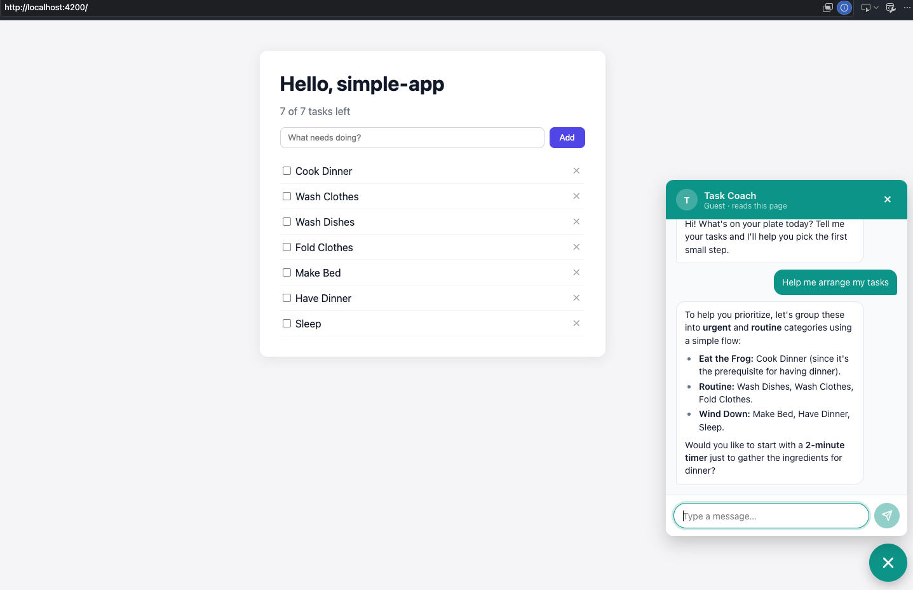

**A Salesforce call-center copilot.** An insurance agent, signed in through Auth0, asks about the policy open on their
screen. The bot names the policyholder, quotes the deductible and spots the open hail claim. The SSN and card number on
screen were masked before leaving the browser.

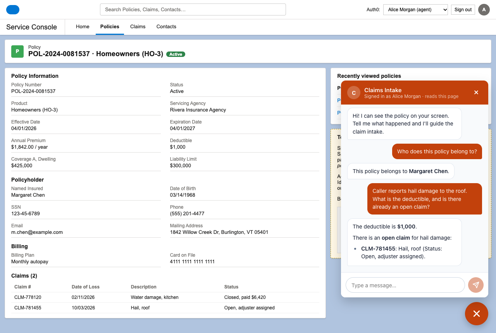

**A role-aware internal assistant.** An employee signed in with Entra ID. The gateway verified the token, so the bot
knows it's Bob and that he has the `HR.Admin` role, and it explains the manager approval procedure that regular
employees don't get.

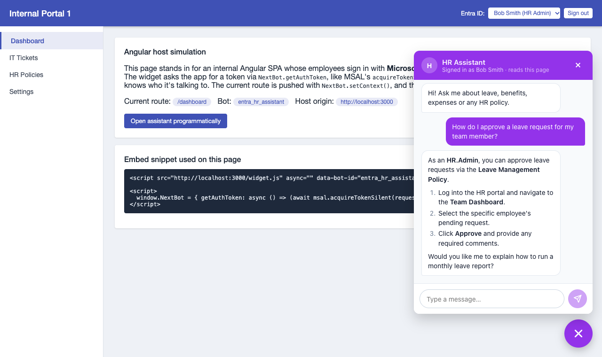

---

## 1. Start the gateway

```bash
docker compose up --build -d      # admin UI at http://localhost:3000
```

Gemma 4 is pulled into Docker Model Runner automatically. Bots are stored in `data/bots.json`.

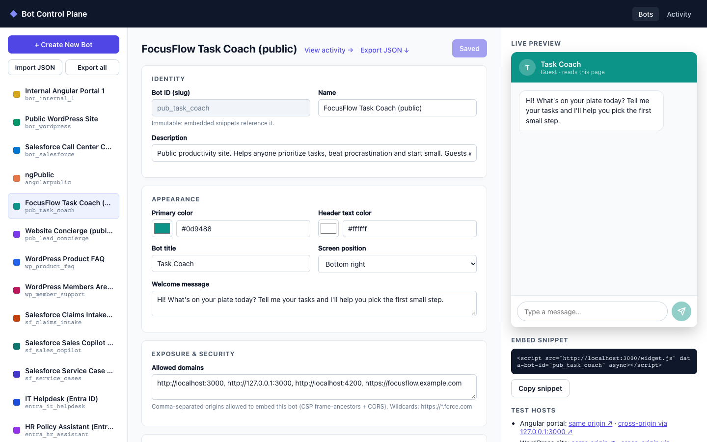

The admin page has three columns:

- **Left:** your bots, **+ Create New Bot**, **Import JSON** and **Export all**.
- **Middle:** the editor for the selected bot.
- **Right:** a live preview, the embed snippet, and links to test pages.

---

## 2. Create a bot

Click **+ Create New Bot**. A new bot starts with all features already configured (copied from the Salesforce
copilot): verified sign-in, screen reading with masking, and Gemma 4. You only need to fill in what's specific to
this bot.

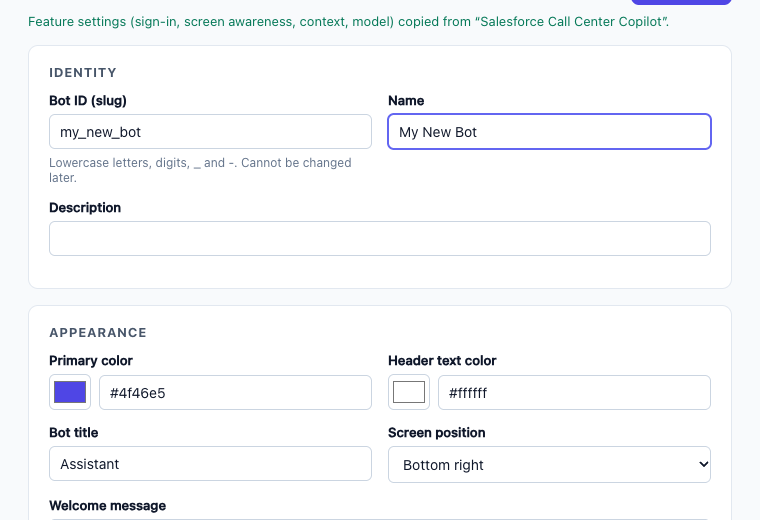

Work through the editor top to bottom:

### 2.1 Identity & appearance


- **Bot ID:** a permanent slug used in the embed code, e.g. `hr_assistant`. Lowercase letters, digits, `_` and `-` only. It can't be changed later.
- **Name / Description:** for admins only.
- **Primary color, header text color, bot title, welcome message, position:** what users see.

### 2.2 Exposure & security: where the bot may appear

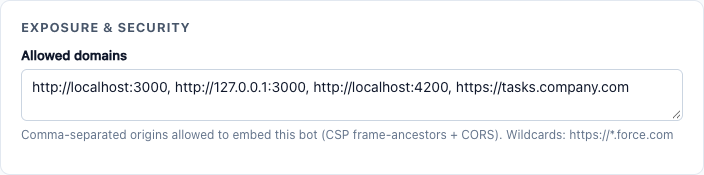

List every site origin that will embed the bot, comma-separated: `https://portal.company.com, https://*.my.salesforce.com`.
Include `http://localhost:4200` (or whatever port you use) for local development. Sites not on this list can't load
the bot: the launcher won't appear, and the chat window refuses to display.

### 2.3 User identity: who is chatting?

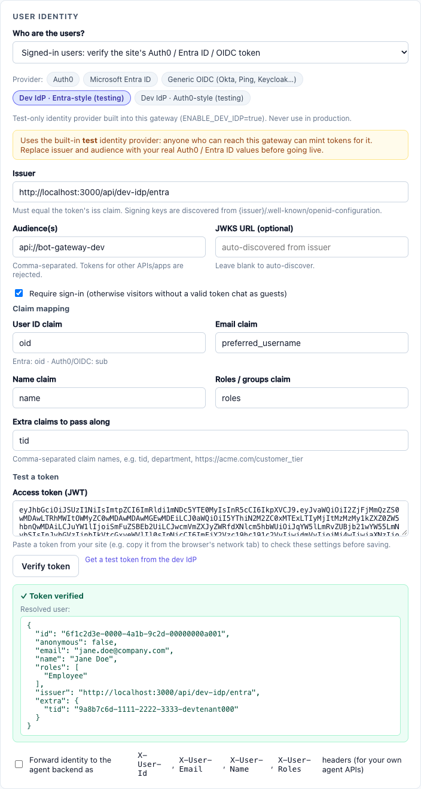

| Your site | Choose | Require sign-in |
| --- | --- | --- |
| Open website, nobody logs in | Signed-in users + any provider preset, or Anonymous | Off |
| Public site where some customers log in (Auth0) | **Auth0** preset | Off: guests chat as "Guest", logged-in customers are recognized |
| Customer portal / members area (Auth0) | **Auth0** preset | **On** |
| Internal app with Microsoft login | **Microsoft Entra ID** preset | **On** |
| Okta, Ping, Keycloak… | **Generic OIDC** preset | as needed |

Then:

1. Replace the placeholders: **Issuer** (e.g. `https://YOUR_TENANT.auth0.com/` or `https://login.microsoftonline.com/<tenant-id>/v2.0`) and **Audience** (your Auth0 API identifier, or `api://<api-client-id>` for Entra).
2. Check the **claim mapping**. The presets are right for most setups; Auth0 roles usually live in a namespaced claim such as `https://your-app.example/roles`.
3. Paste a real token from your site into **Test a token → Verify token**. You'll see the resolved user, or the exact reason it failed (wrong issuer, audience, expired…).

The gateway only trusts identity from a token it verified itself. Anything a page *says* about the user is passed to
the model as unverified.

### 2.4 Context & screen awareness: what the bot can see

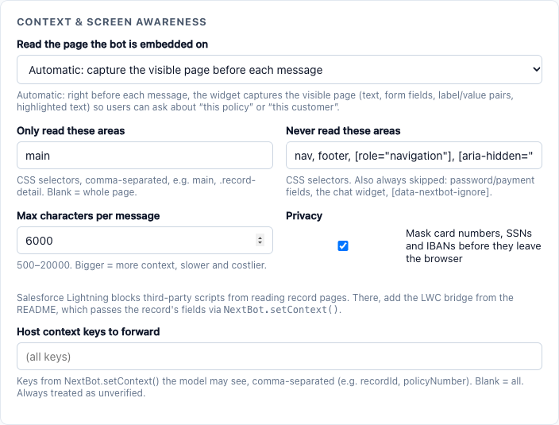

- **Automatic** (recommended): before every message, the bot reads the visible page: text, form fields, label/value pairs and anything the user has highlighted. This is how it answers "who does *this* policy belong to?".
- **Only read these areas:** CSS selectors like `main` or `.record-detail` keep the bot focused. Blank means the whole page.
- **Never read these areas:** e.g. `nav, footer, .internal-notes`. You can also add `data-nextbot-ignore` to any element in your HTML.
- **Mask card numbers, SSNs and IBANs:** leave on.
- **Host context keys to forward:** which values sent by your app via `NextBot.setContext()` the model may see (blank = all).

### 2.5 Agent routing: which model answers

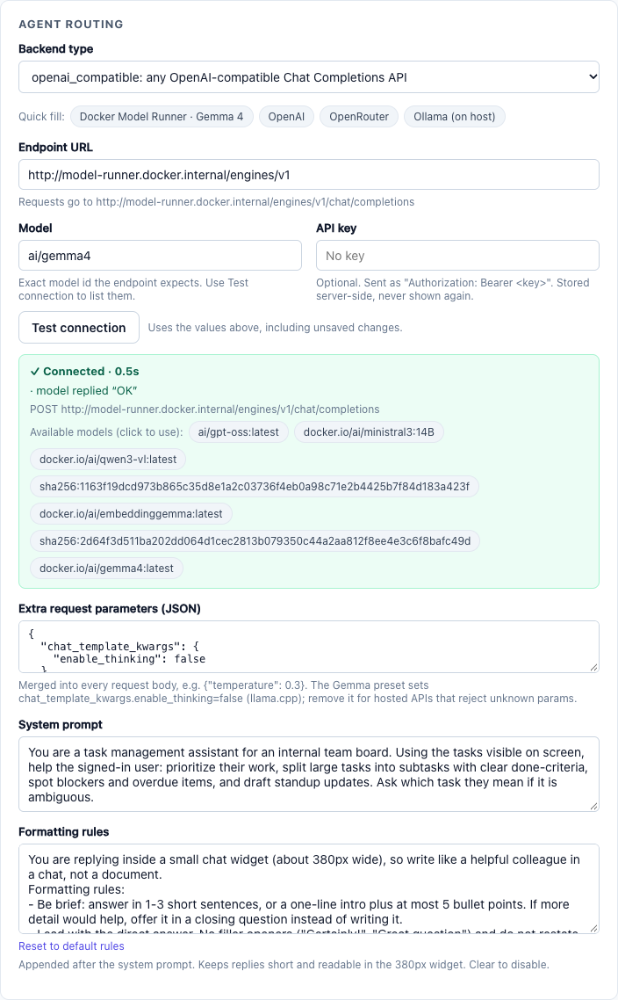

- Use **Quick fill** (Docker Model Runner · Gemma 4, OpenAI, OpenRouter, Ollama) or type any OpenAI-compatible **Endpoint URL**.
- **Model** and **API key** (the key is stored server-side and never shown again).
- Click **Test connection**: it sends a test message and lists the endpoint's models. Click a model to use it.
- **System prompt:** the bot's job, tone and limits. Be specific about what it should and shouldn't do.
- **Formatting rules:** keep the defaults; they make answers short and readable in the chat window.

### 2.6 Save

Click **Create bot** (top right, or in the save bar that sticks to the bottom of the screen). If something is wrong,
the save bar turns red with the reason and the page scrolls to the error list. Saved bots are written to
`data/bots.json`, and the previous version is kept in `data/backups/`.

---

## 3. Embed it on a site

Copy the snippet from the right-hand column (**Embed snippet → Copy snippet**):

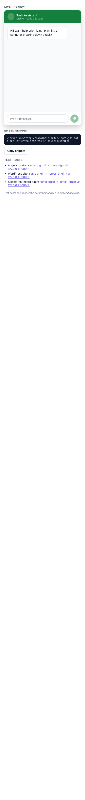

### Plain HTML / any site

```html
<script src="https://YOUR-GATEWAY/widget.js" data-bot-id="pub_task_coach" async></script>
```

That's all an open website needs. Screen reading works automatically.

### Angular

Add the script tag to `src/index.html` (this is how the Task Coach screenshot above was made):

```html
<!-- src/index.html -->
<body>
  <app-root></app-root>
  <script src="http://localhost:3000/widget.js" data-bot-id="pub_task_coach" async></script>
</body>
```

Optional: tell the bot which route the user is on:

```ts
// app.component.ts
import { Component } from '@angular/core';
import { NavigationEnd, Router } from '@angular/router';
import { filter } from 'rxjs';

declare global { interface Window { NextBot?: any } }

@Component({ selector: 'app-root', templateUrl: './app.component.html' })
export class AppComponent {
  constructor(router: Router) {
    router.events.pipe(filter((e): e is NavigationEnd => e instanceof NavigationEnd))
      .subscribe((e) => window.NextBot?.setContext?.({ route: e.urlAfterRedirects }));
  }
}
```

**Signed-in users with Entra ID (MSAL Angular).** Give the widget a token provider. It's called when the chat opens
and again whenever the token expires:

```ts
// app.component.ts (inject MsalService)
window.NextBot = window.NextBot ?? {};
window.NextBot.getAuthToken = async () => {
  const account = this.msal.instance.getActiveAccount();
  if (!account) return null; // not signed in -> guest or "sign-in required"
  const result = await this.msal.instance.acquireTokenSilent({
    account,
    scopes: ['api://<YOUR_API_CLIENT_ID>/access_as_user'],
  });
  return result.accessToken;
};
```

**Signed-in users with Auth0 (`@auth0/auth0-angular`):**

```ts
// app.component.ts (inject AuthService from @auth0/auth0-angular)
import { firstValueFrom } from 'rxjs';

window.NextBot = window.NextBot ?? {};
window.NextBot.getAuthToken = () =>
  firstValueFrom(this.auth.getAccessTokenSilently({ authorizationParams: { audience: 'https://your-api-identifier' } }))
    .catch(() => null);

// Keep the chat in sync when the user logs in or out without a page reload:
this.auth.isAuthenticated$.subscribe(async (signedIn) =>
  window.NextBot?.setAuthToken?.(signedIn ? await window.NextBot.getAuthToken() : null));
```

### WordPress

Paste the snippet into a **Custom HTML** block, the theme footer, or a header/footer plugin (e.g. WPCode). For an open
site nothing else is needed. If your site logs customers in with Auth0 and has their access token available in the
browser, set `window.NextBot = { getAuthToken: () => /* return the token */ }` before the snippet.

### Salesforce

Salesforce Lightning blocks third-party scripts from reading the record page, so screen capture can't see Lightning
records. Use the small Lightning Web Component in the [README](../README.md#salesforce-lightning): it reads the
record's fields and passes them with `NextBot.setContext()`. Also add the gateway URL to **Setup → CSP Trusted Sites**.

### Runtime API (all sites)

| Call | What it does |
| --- | --- |
| `NextBot.getAuthToken = async () => token` | Token provider (Auth0 / MSAL). Return `null` when signed out. |
| `NextBot.setAuthToken(token \| null)` | Push a new token, or sign out, without reloading |
| `NextBot.setContext({ ... })` | Send exact values the bot should know (record ID, route, cart…) |
| `NextBot.open()` / `close()` / `toggle()` | Control the chat window from your own buttons |
| `data-nextbot-ignore` attribute | The bot never reads this element |

---

## 4. How end users use it

1. Click the round launcher in the corner.
2. The header shows who they are: **Signed in as Alice Morgan**, **Guest**, or **Sign-in required**, plus **reads this page** if screen reading is on.
3. Ask about what's on screen in plain words:
   - "Who does this policy belong to?" / "Is it active?" / "What's the deductible?"
   - "Help me arrange my tasks" / "Break 'Migrate CRM' into subtasks"
   - Highlight a sentence on the page, then ask "what does this mean?"
4. Navigating to another record or page is picked up on the next message, with no reload needed.
5. If their sign-in expires, the chat quietly gets a fresh token from the site. If they sign out, the chat asks them to sign in.

---

## 5. Test before going live

- **Test hosts:** the right-hand column links to three test pages (Angular portal, WordPress site, Salesforce console), each pre-set for the selected bot. The *cross-origin* links load the page from `127.0.0.1` to simulate a real third-party site.
- The test pages sign in through the gateway's built-in **test identity provider**, using Entra-style or Auth0-style accounts (Jane/Bob, Alice/Carol/Dana). Use the toolbar to switch user or sign out.
- **Test connection** (Agent routing) and **Verify token** (User identity) check your real endpoints and tokens with unsaved settings.

---

## 6. Monitor activity

Open **Activity** in the top bar, or **View activity →** on a bot.

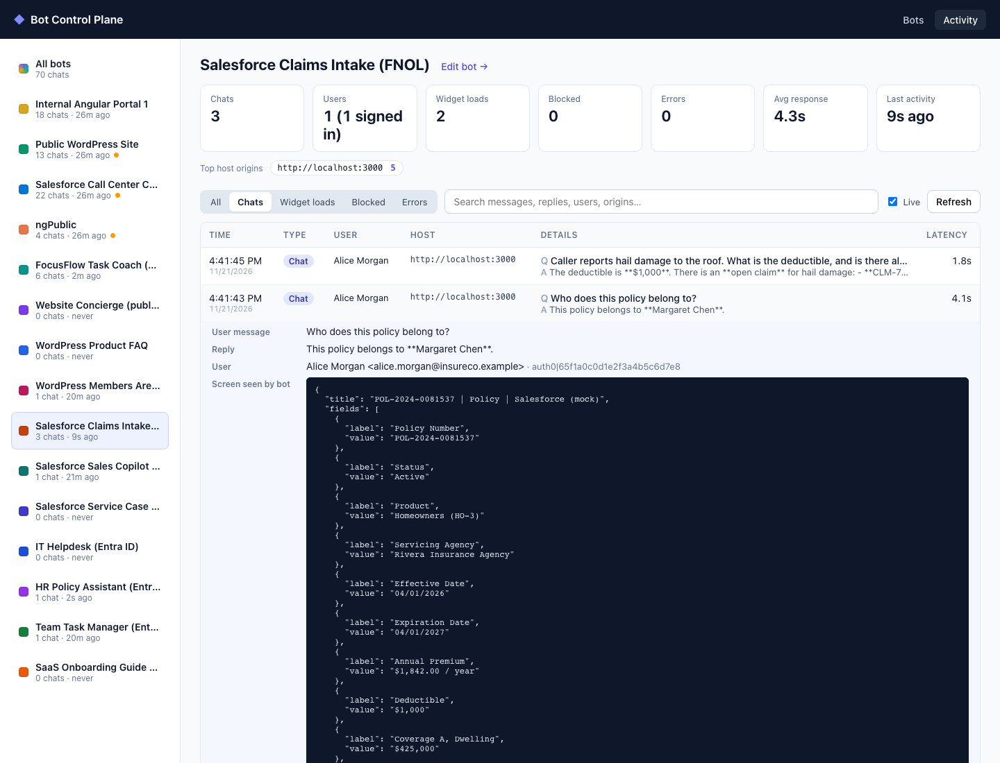

- **Per bot:** chats, users (and how many signed in), widget loads, blocked requests, errors, average response time and the top host sites.
- **Feed:** filter by type, search messages, users or sites, and turn on **Live** refresh.
- Click a row to see the full question and answer, the verified user, and **Screen seen by bot**: exactly which fields and text the bot read.
- **Blocked** events show sites that tried to load a bot without being allowed, and users without a valid sign-in.

---

## 7. Manage bots: export, import, backups

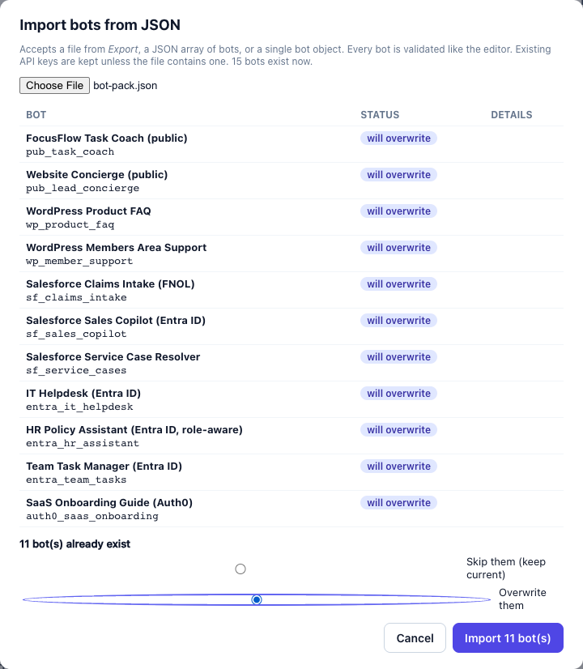

- **Export all** / **Export JSON ↓** (per bot) downloads a JSON file. API keys are never included.
- **Import JSON** shows a preview first (new / exists / invalid, with reasons). Choose **Skip** or **Overwrite** for existing bots. Invalid files are never written.
- `examples/bot-pack.json` contains 11 ready-made bots: public sites, WordPress, Salesforce, Entra ID and Auth0 apps, task management.
- Every save keeps the previous version in `data/backups/` (last 30). To roll back, copy a backup over `data/bots.json`.

---

## 8. Go-live checklist

- [ ] Set `ADMIN_PASSWORD` (and optionally `ADMIN_USER`) in `docker-compose.yml`. Without it, the admin UI is open to anyone who can reach it.
- [ ] Set `ENABLE_DEV_IDP=false`, and point every signed-in bot at your **real** Auth0 / Entra ID issuer and audience. The editor shows a warning while a bot still trusts the test provider.
- [ ] Put only production origins in each bot's **Allowed domains**.
- [ ] Serve the gateway over **https**. Set `PUBLIC_BASE_URL` if it runs behind a reverse proxy.
- [ ] Replace the `localhost:3000` gateway URL in your embed snippets.
- [ ] Review each bot's **Never read these areas** for screens with sensitive data.
- [ ] Back up the `data/` folder. It holds bots, API keys and the activity log.

---

## Troubleshooting

| Symptom | Likely cause | Fix |
| --- | --- | --- |
| No launcher on the page | The site isn't in **Allowed domains** (browser console shows `HTTP 403`) | Add the exact origin, e.g. `http://localhost:4200` |
| Launcher appears but the chat window is blank | Same: the window refuses to display on unlisted sites | Add the origin, save, reload the page |
| "Sign-in required" although the user is logged in | No token provider, or wrong issuer/audience | Set `NextBot.getAuthToken`; check with **Verify token** |
| Shows "Guest" for a logged-in user | Sign-in isn't required and the token failed verification | **Activity** shows the reason on the chat event; fix issuer/audience/claims |
| Bot doesn't know what's on screen | Screen reading off, or the content is outside **Only read these areas** | Set Automatic; adjust selectors. In Salesforce use the LWC bridge |
| Replies are slow (10–20 s) | Gemma's thinking mode is on | Keep `{"chat_template_kwargs": {"enable_thinking": false}}` in **Extra request parameters** |
| "Could not reach …" on Test connection | Wrong URL, or the model server isn't running | Check the URL; for Gemma run `docker model status` |
| Bot didn't save | Validation error | Read the red save bar; also `docker compose logs` shows `[bots] rejected save …` |
